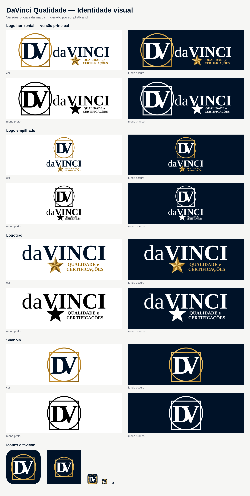

# DaVinci Qualidade — Identidade visual



## Conceito

O monograma **DV** fica dentro da construção Vitruviana de Leonardo da Vinci: um **círculo** e um **quadrado** tangentes na base. É o mesmo símbolo de toda a família DaVinci. O nome **da VINCI** em serifa clássica passa autoridade. A tagline **QUALIDADE e CERTIFICAÇÕES**, em ouro escuro, vem com uma **estrela dourada biselada**, que remete a selo e certificação, e identifica o produto.

## Estrutura

```text
brand/
├── README.md               ← este guia
├── preview.png             ← folha com todas as versões
├── source/
│   ├── original/           ← logo original enviada (raster, não editar)
│   └── fonts/              ← Liberation Serif (OFL), usada para converter o texto em curvas
├── svg/                    ← VETORES OFICIAIS (fonte da verdade)
│   ├── logo-horizontal/    ← versão principal
│   ├── logo-empilhado/
│   ├── logotipo/
│   ├── simbolo/
│   └── icone-app/          ← ícone de app + maskable (PWA/Android)
├── png/                    ← exportações raster (geradas, não editar)
│   ├── logo-horizontal/  logo-empilhado/  logotipo/  simbolo/
│   ├── icone-app/          ← 1024/512/192, maskable, apple-touch-icon
│   ├── social/             ← Open Graph, capa do LinkedIn, avatar
│   └── email/              ← assinatura de e-mail
└── favicon/                ← favicon.ico (16/32/48) + icon.svg
```

Quando o `apps/web` existir, o `pnpm brand:export` copia as peças para:

```text
apps/web/src/app/      favicon.ico · icon.svg · apple-icon.png · opengraph-image.png
apps/web/public/brand/ logo*.svg · simbolo*.svg · icon-192/512.png · icon-maskable-512.png
```

## Versões

| Versão              | Quando usar                                                               |
| ------------------- | ------------------------------------------------------------------------- |
| **Logo horizontal** | **Padrão.** Cabeçalho do sistema, site, documentos, certificados, e-mails |
| **Logo empilhado**  | Espaços quadrados ou verticais: tela de login, splash, crachás            |
| **Logotipo**        | Quando o símbolo já aparece por perto, ou não há altura para ele          |
| **Símbolo**         | Favicon, avatar, marca d'água, espaços pequenos                           |
| **Ícone de app**    | PWA, lojas de apps, atalhos (símbolo sobre fundo marinho)                 |

Cada versão tem quatro variantes de cor:

| Sufixo          | Fundo         | Observação                                     |
| --------------- | ------------- | ---------------------------------------------- |
| _(sem sufixo)_  | Claro         | Versão colorida principal                      |
| `-fundo-escuro` | Escuro        | Texto em branco, dourado e tagline mais claros |
| `-mono-preto`   | Claro         | Impressão em 1 cor, carimbo, gravação          |
| `-mono-branco`  | Escuro / foto | Sobre imagens ou fundos coloridos              |

Os PNGs vêm com fundo transparente e são exportados em várias larguras (sufixo `-512`, `-1024`, `-2048`…). Use SVG sempre que puder e PNG só onde SVG não é aceito.

## Cores

| Nome           | HEX                                           | Uso                                 |
| -------------- | --------------------------------------------- | ----------------------------------- |
| Marinho        | `#001228`                                     | Monograma, "da VINCI", fundo escuro |
| Ouro           | `#A06D10` (claro `#E3A945`, escuro `#7A520A`) | Moldura Vitruviana e estrela        |
| Ouro Qualidade | `#986600` (no fundo escuro: `#E8B860`)        | Tagline QUALIDADE e CERTIFICAÇÕES   |

## Regras de uso

- **Área de proteção:** deixe ao redor da marca um espaço livre de pelo menos a altura da letra **V** do monograma.
- **Tamanho mínimo:** logo horizontal com 160 px (ou 40 mm) de largura, para a tagline continuar legível. Símbolo com 24 px. Abaixo disso, use o `favicon/icon.svg`, que tem traço reforçado.
- **Não faça:** distorcer, girar, trocar as cores, separar o DV da moldura, separar a estrela da tagline, aplicar sombras ou contornos, ou usar a versão colorida sobre fundo sem contraste (nesse caso, use a mono).

## Regenerar

```bash
pip install -r scripts/brand/requirements.txt   # fonttools + Pillow (ImageMagick 7 também é necessário)
pnpm brand:svg      # reconstrói os SVGs (svg/, favicon/icon.svg)
pnpm brand:export   # exporta PNGs, favicon.ico, peças sociais, preview e sincroniza o apps/web
```

> **Sobre os vetores:** a logo original existe só em raster. Os SVGs foram reconstruídos a partir das medidas exatas dela, com o texto convertido em curvas. Se o designer entregar o vetor original (.ai, .svg ou .pdf), guarde-o em `source/original/` e substitua os SVGs.
