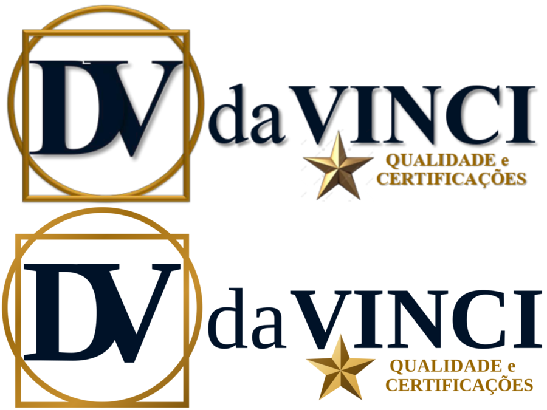

# Identidade visual: logos da DaVinci Qualidade

> **Status:** concluído · **Data:** 14/10/2026
> **Escopo:** kit de logos da marca em `brand/`, no mesmo pipeline da DaVinci Finance

---

## 1. Resumo

Partimos de **uma única imagem** da logo DaVinci Qualidade, em PNG com 951 × 343 px (`brand/source/original/`). Assim como na DaVinci Finance, ela foi:

- **reconstruída em vetor (SVG)**, com o texto convertido em curvas;
- desdobrada em **5 layouts** (horizontal, empilhado, logotipo, símbolo e ícone de app) × **4 variantes de cor** (colorida, fundo escuro, mono preto e mono branco);
- exportada em **PNGs de vários tamanhos**, `favicon.ico`, ícones de PWA/iOS, imagem de compartilhamento, capa e avatar para redes sociais e assinatura de e-mail.

Todo o kit é regenerado com `pnpm brand:svg` e `pnpm brand:export`. O guia de uso fica em [brand/README.md](../../brand/README.md).

---

## 2. Análise da logo original

### 2.1 O que é igual à DaVinci Finance

O **símbolo** (DV na moldura Vitruviana) e o **"daVINCI"** são os mesmos da Finance: as posições relativas de cada letra coincidem. A diferença é só de escala. A arte da Qualidade é a da Finance **ampliada em 1,0866×**. Exemplos:

| Medida                        | Finance | Qualidade | Razão  |
| ----------------------------- | ------- | --------- | ------ |
| Largura do DV                 | 164 px  | 178 px    | 1,0854 |
| Da borda do D ao fim de VINCI | 543 px  | 590 px    | 1,0866 |

**Decisão:** reaproveitar **as mesmas coordenadas e o mesmo código** da Finance para o símbolo e o nome, e converter para esse espaço só o que é novo. Assim o símbolo é idêntico, até o último ponto, em toda a família DaVinci.

### 2.2 O que é novo

Convertido para o espaço da Finance com `x' = 156 + (x − 180) / 1,0866` e `y' = 87 + (y − 96) / 1,0866`:

| Elemento                                   | Medida na original da Qualidade                          | No espaço do script                              |
| ------------------------------------------ | -------------------------------------------------------- | ------------------------------------------------ |
| **Estrela** de 5 pontas, regular, biselada | centro (540,5; 222), raio 42                             | centro (487,7; 198,6), raio 38,65                |
| **QUALIDADE e** (serifada bold)            | x 597 → 739, linha de base 218,5, maiúsculas com 13,5 px | x 539,8 → 670,4, base 199,7, maiúsculas com 12,4 |
| **CERTIFICAÇÕES** (serifada bold)          | x 592 → 759, linha de base 240,5                         | x 535,2 → 688,9, base 220,0                      |

### 2.3 Cores

Contagem de pixels por região, como na Finance:

| Nome           | HEX                                        | Onde aparece                               |
| -------------- | ------------------------------------------ | ------------------------------------------ |
| Marinho        | `#001228`                                  | Monograma DV e "daVINCI" (igual à Finance) |
| Ouro           | `#A06D10` / `#E3A945` / `#7A520A`          | Moldura (igual à Finance)                  |
| Ouro Qualidade | `#986600`                                  | Tagline                                    |
| Estrela        | de `#FFFFC5` (brilho) a `#614629` (sombra) | Metal biselado                             |

---

## 3. Como foi feito

O pipeline é o mesmo da Finance (ver o `docs/04-design/logos.md` daquele projeto): `scripts/brand/build_svgs.py` gera os vetores, e `scripts/brand/export_rasters.py` gera os PNGs, o `.ico`, as peças sociais e a prévia. As mudanças foram:

| Peça                    | Como foi feita                                                                                                                                                                                                                                                                                            |
| ----------------------- | --------------------------------------------------------------------------------------------------------------------------------------------------------------------------------------------------------------------------------------------------------------------------------------------------------- |
| Tagline                 | Função `text_paths()`: compõe cada linha com o avanço natural da Liberation Serif Bold e distribui a sobra como espaçamento entre letras, até encaixar nas bordas medidas. Os acentos (Ç, Õ) saem dos glifos compostos da própria fonte.                                                                  |
| Estrela                 | 10 triângulos a partir do centro, com faces claras e escuras alternadas e um gradiente em cada uma: o bisel da original, com luz vindo de cima à esquerda. Nas versões mono, vira uma estrela chapada. O raio interno é 0,42 do externo, um pouco mais cheio que a estrela regular (0,382), como na arte. |
| Fundo escuro            | Tagline em `#E8B860` e estrela com tons de ouro mais claros, para manter o contraste sobre o marinho                                                                                                                                                                                                      |
| Sincronização com o web | Pulada enquanto `apps/web` não existe. Quando ele for criado, o `pnpm brand:export` copia o favicon, os ícones, a imagem de compartilhamento e as logos.                                                                                                                                                  |

---

## 4. Limitações e próximos passos

- **Os SVGs são uma reconstrução**, fiéis às medidas, mas não são o arquivo de criação. Se o designer tiver o vetor original, ele deve substituir a reconstrução.
- **Sem relevo nem sombra** no texto, de propósito: assim como na Finance, o visual chapado funciona em tamanhos pequenos e em impressão. Só o dourado e a estrela mantêm gradiente.
- **A tagline é pequena** (~6 % da altura da logo horizontal). Por isso o tamanho mínimo da logo horizontal é maior que o da Finance: 160 px.
- **Sistema de cores** (`brand/tokens`, `@davinci/tokens`): ainda não portado. Na Finance, a cor de destaque é o laranja do FINANCE. Na Qualidade, o candidato natural é o ouro da tagline.
